# 🏓 Table Tennis Tournament

A web app for running an office table-tennis tournament: sign-ups via a shared link, two qualifying rounds, a Lucky Losers round, a seeded knockout bracket, a podium with laurels, one standings table with qualification cut-offs, a match timer and stats. The interface comes in Polish and English.

**[▶ Open the demo](https://mr-powerbi-data.pl/table-tennis-tournament/)**: it runs in your browser, you are the organizer and you can play a whole tournament from sign-ups to the podium.

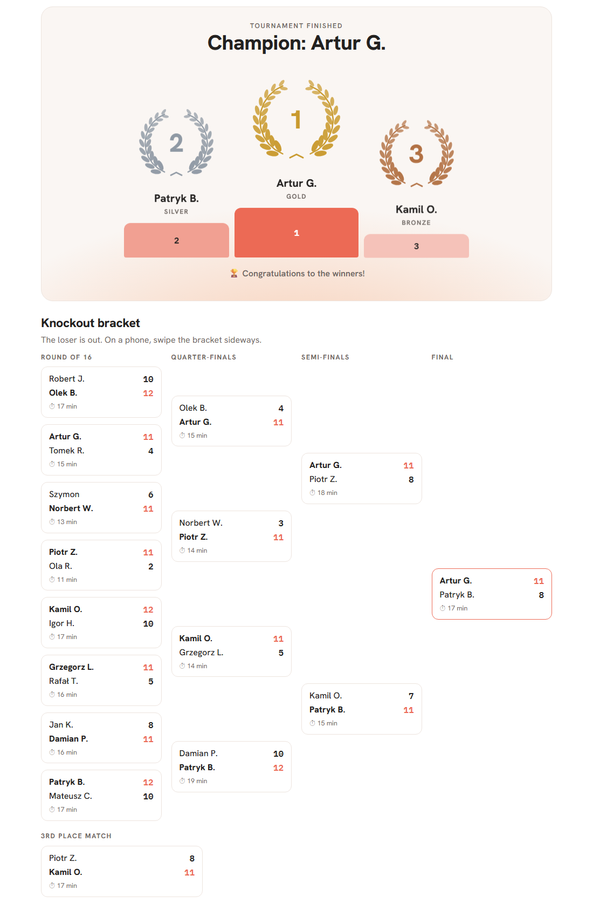

*English interface. Every screenshot below exists in English and Polish.*

> **Vibecoded.** The first working version was live about 20 minutes after the first prompt, built in a conversation with AI (Claude), and then went through a few quick iterations of fixes. It was made on the spot for a company team-building event, where close to 30 people signed up for a just-for-fun tournament. There was no design and no spec, only prompts in a chat. I dictated most of them by voice from my phone, and some features were added while the games were already being played. The process is described below.

The app was built in Polish, because that's who it was built for, and later got an English version: a PL/EN switch sits in the top-right corner. The documentation and code structure are described here in English.

---

## Features

**For participants (regular link)**
- Sign yourself up, or several people from one phone. Your own entries can be withdrawn until the draw.
- Live view: the page refreshes itself every few seconds.
- Current stage, one combined standings table, bracket, podium, all results and a collapsible stats panel (right under the bracket).
- Organizer panel opens as a pop-up from a button at the top, so there is no scrolling to the bottom.
- A "How it works" button in the top bar jumps to the rules once the tournament has started (before that they are open at the top).
- The standings table can show the final places or the rounds 1–2 ranking with the qualification cut-offs and a **Status** column: who is still in the tournament and who drops out at the current positions.
- Polish and English UI: PL/EN switch in the top-right corner (defaults to the browser language, remembered per device, `?lang=en` forces a language). Server and engine messages are translated in the browser.
- **Live tables** banner (collapsible, can be hidden; the viewer's choice is remembered in the browser): which match is on which table, who is up next; the organizer can start matches and enter results right there. The organizer sets the number of tables (1–16); a started match takes the lowest free table.
- Stats grow with the tournament: a card only appears when there is enough data and the value is not shared by most players (e.g. no "most wins" when everybody has one win). The demo's random tournament simulates about 5 minutes per match.
- Match timer: the organizer taps *Start* on a match, entering the result ends it. Stats then show average, longest and shortest match time and how deuce games affect length. With set points entered, stats also cover single sets (biggest and closest set, deuce sets) and match-level extras such as matches that went the distance, the comeback king and the best set difference.
- Matches of the people signed up from your phone are highlighted.
- Demo only: a **Random tournament** button creates and draws a tournament with a random number of players (6–32), match format (1–3 sets), bracket size and Lucky Losers spots, and the random results include the occasional long deuce game such as 15:13 or 18:16.

**For the organizer (link with a secret token)**
- Score entry validated against the rules (first to 11, win by two). Two modes, switchable in the organizer panel:
  - **Points** (default): for one-set matches the points of the set (e.g. 11:7, 12:10); for matches played to 2 or 3 sets the points of **every set** (e.g. 11:9, 7:11, 12:10), and the match score (2:1) is worked out automatically. The form only shows another set row while the match is undecided.
  - **Sets only** (faster): quick presets such as 2:0, 2:1, 1:2, 0:2 (for one set: just the winner). Point-based stats are then skipped, match-level stats still work.
- Manual draw, or an automatic draw at a set time.
- Adding late players during rounds 1 and 2, so they still get their two matches.
- Rolling the tournament back to an earlier stage without losing earlier results.
- Settings: name, match format (1–3 sets), score entry mode, **qualification format** (1–6 random-opponent rounds, or groups with a chosen size and 1–2 advancing per group) and the **knockout stage** (see below). There is no hidden automatic setting: every choice is explicit.
- **Knockout stage settings, computed from the number of players.** The organizer picks what share of the field advances directly (70% down to 10%, with the resulting number of players next to each percentage, always an **even** number rounded **up**, recommended: the one closest to half of the players). **Lucky Losers** are a yes/no choice. If yes, a second list shows how many join the direct qualifiers (always a count that keeps the bracket even, recommended: about half of the pool of players who did not qualify directly), and a third choice says how they are decided: a **play-off** (they play one more match against each other) or **by the table** (they simply advance by their position). In groups mode the direct qualifiers are the top 1–2 of every group and the Lucky Losers come from the players placed right behind them (e.g. the third places, each group contributes one). A live summary under the choices says what it all means, for example "10 straight in + 2 Lucky Losers = 12 players, play-in round: the 8 lowest seeds play 4 matches, the best 4 have a bye".

**Tournament format.** The organizer picks the qualification format before the draw:

*Random-opponent rounds* (default, 1 to 6 rounds, everyone plays at least that many matches):
1. **Round 1.** Random pairs, everyone plays one match.
2. **Round 2 and later.** Players with the same record play each other (round 2: winners vs winners, losers vs losers). From round 3 on, rematches are avoided where possible.
3. **Ranking.** Wins, then point (or set) difference, then points scored. Already during the last round the page shows who is guaranteed a place and should stay around.

*Groups* (round-robin, like a football European or World Cup):
1. Players are drawn into groups of about 3 to 6 (sizes differ by at most one), and in a group everyone plays everyone once.
2. The top 1 or 2 of every group advance directly. The bracket places that are left go to the **best of the rest** (for example the best third-placed players), compared by per-match averages so that groups of different size are fair. Optionally some of those places are decided in Lucky Losers matches.

Then, in both formats:
- **Lucky Losers** (optional). Players from outside direct qualification who are added to the knockout stage, either after a play-off match (higher-ranked vs lower-ranked, the winners go through) or simply by the table. They can be switched off.
- **Bracket.** Any number of players works, not only powers of two. Seeded 1st vs last, 2nd vs second-to-last and so on (after groups, the first matches avoid pairing two players from the same group where possible), plus a third-place match and the podium. When the number of players is not a power of two, the lowest seeds play a **play-in round** and the best of the table have a **bye** (for 10 players: 4 play 2 matches, the best 6 wait). It is always a single elimination with exactly M−1 matches, byes go to the best of the table, and options that give a full bracket are marked in the panel.

With an odd number of players in a round, the player without a pair gets an extra match against a random opponent that only counts for them.

### Screenshots

| English | Polski |
|---|---|
|  | 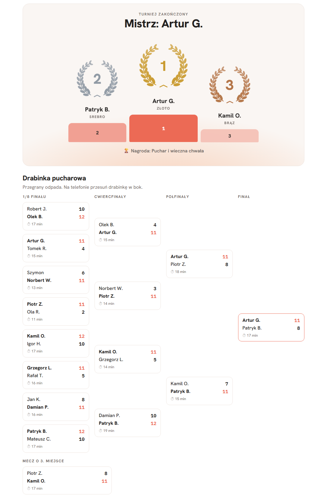 |
| 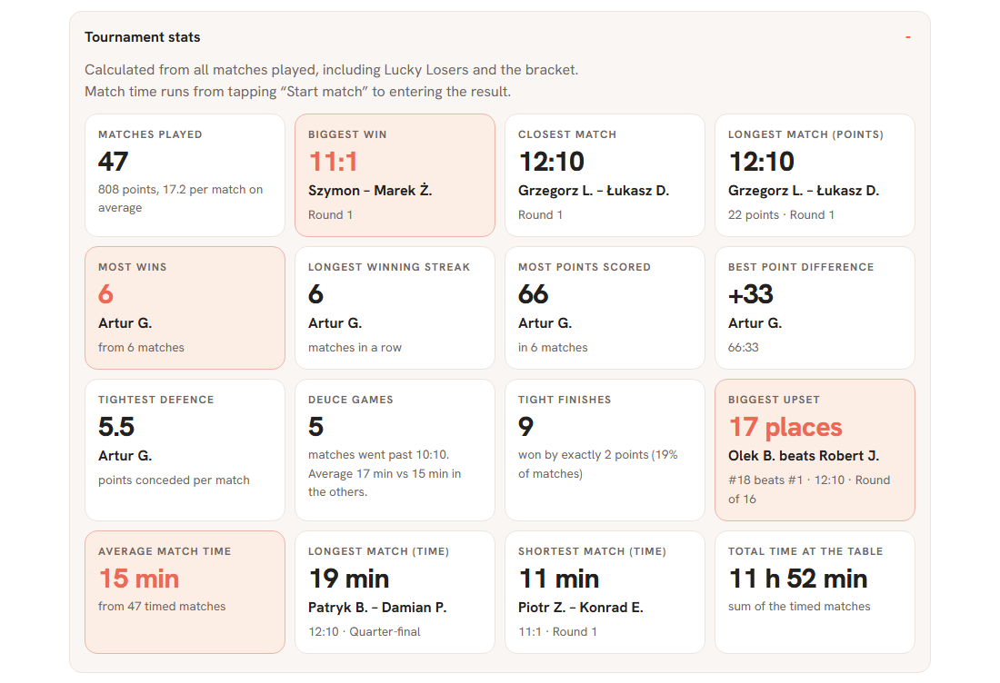 | 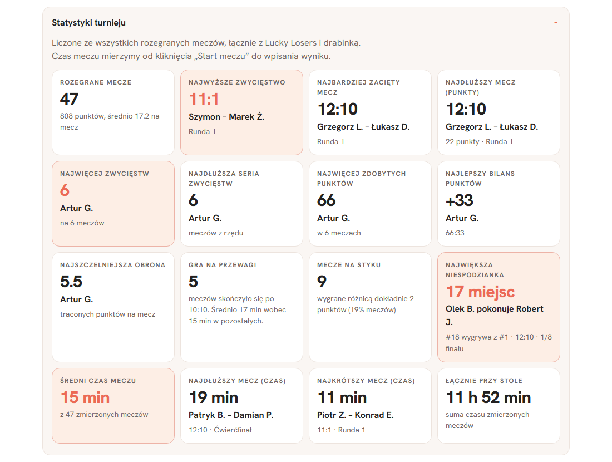 |
| 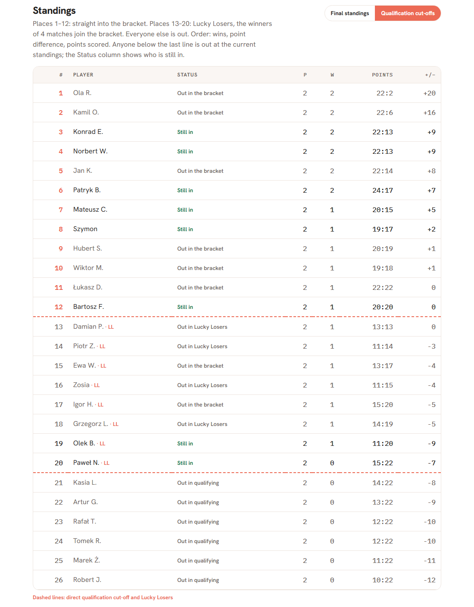 | 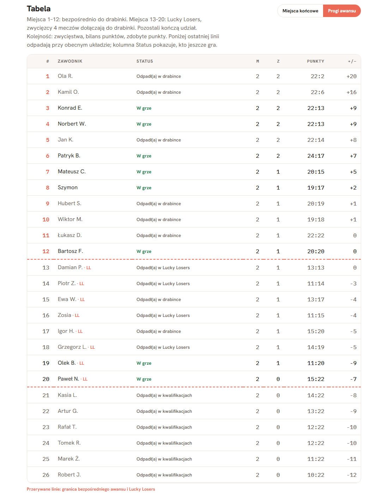 |

| Round 2 on a phone (dark mode), EN | Round 2, PL | Score entry with the match timer, EN | Score entry, PL |
|---|---|---|---|
| 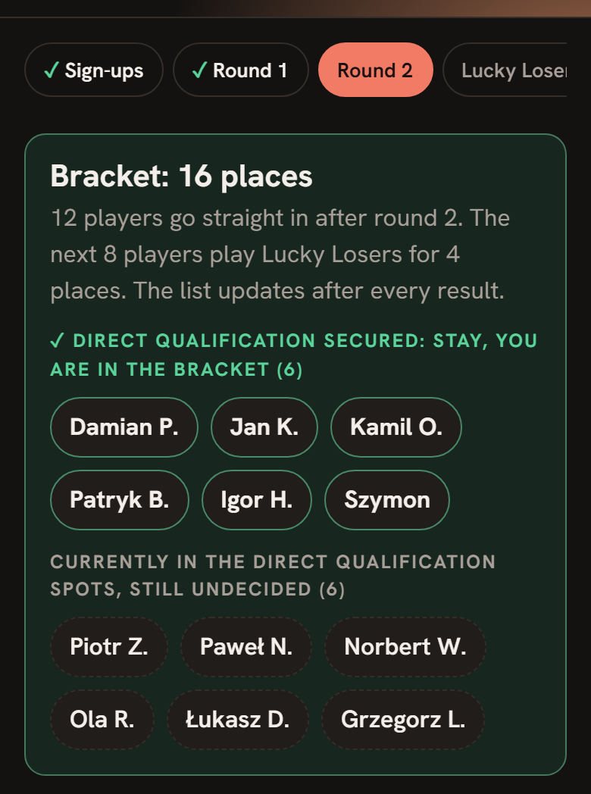 | 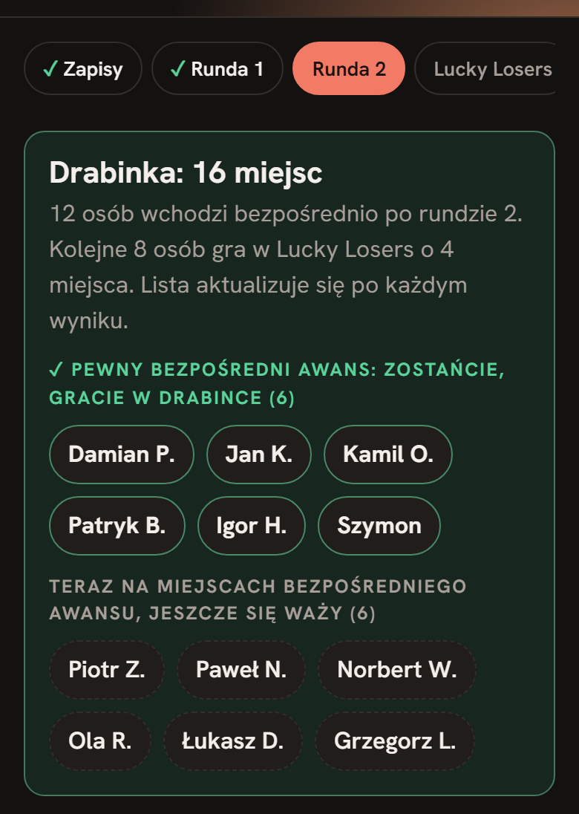 | 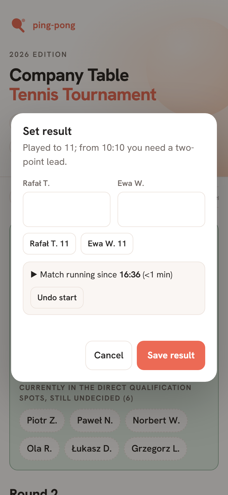 | 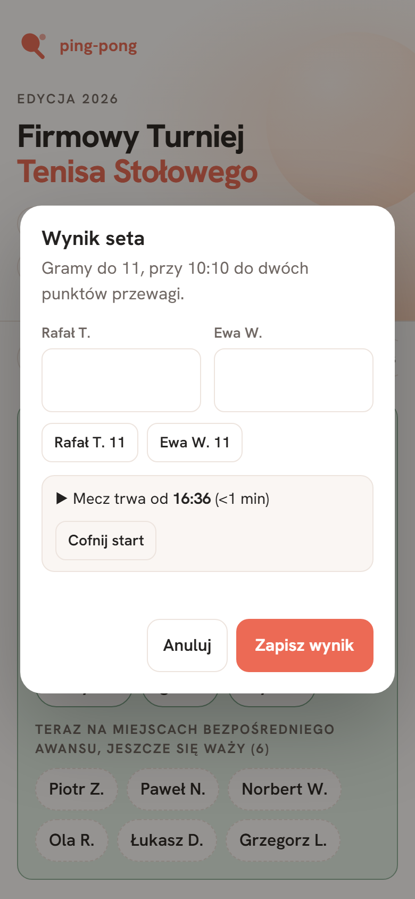 |

| Match to 2 sets: points of every set (EN) | Mecz do 2 setów: punkty każdego seta (PL) |
|---|---|
| 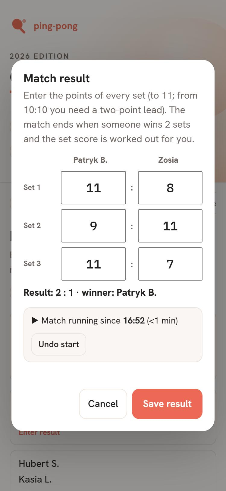 | 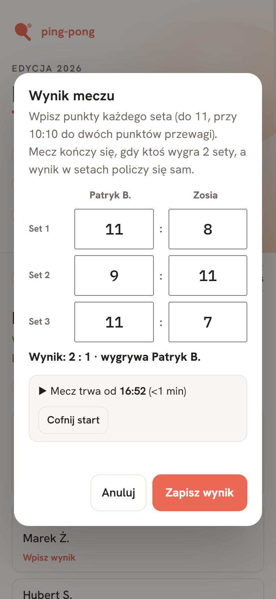 |

| Organizer panel: knockout stage settings (EN) | Panel organizatora: ustawienia fazy pucharowej (PL) |
|---|---|
| 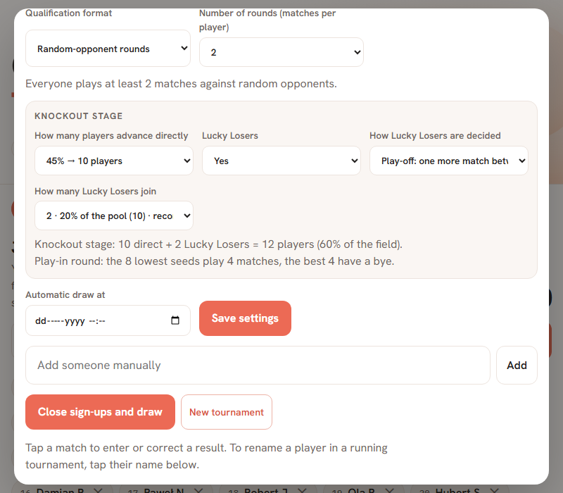 | 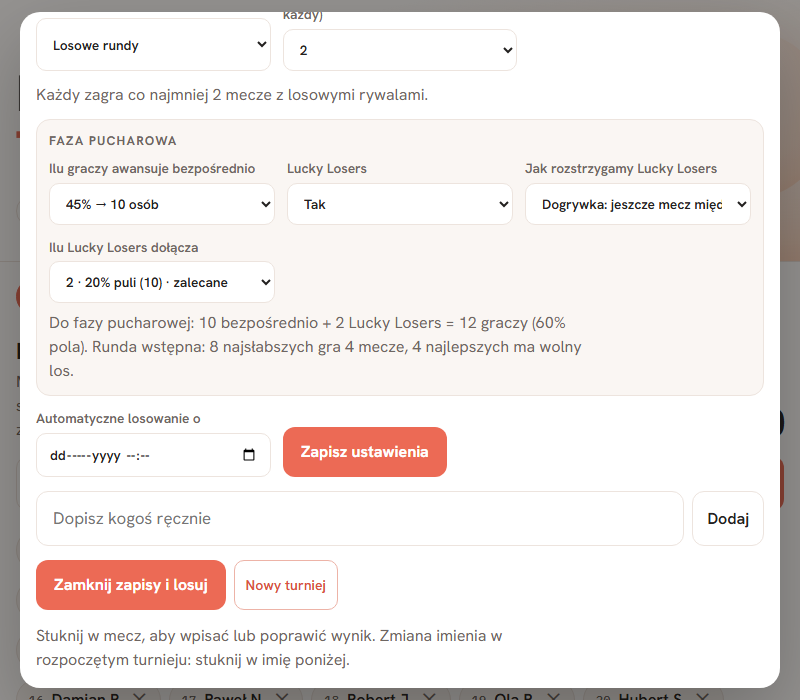 |

| Bracket with a play-in round: 10 players, the best 6 have a bye (EN) | Drabinka z rundą wstępną: 10 graczy, 6 najlepszych ma wolny los (PL) |
|---|---|
| 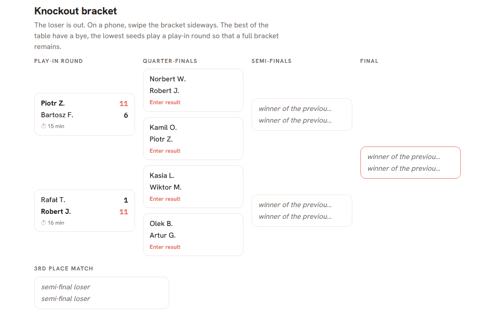 | 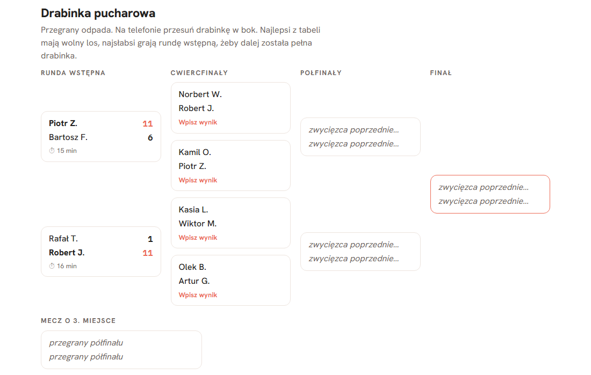 |

| Group stage: group tables with the qualification line (EN) | Faza grupowa: tabele grup z linią awansu (PL) |
|---|---|
| 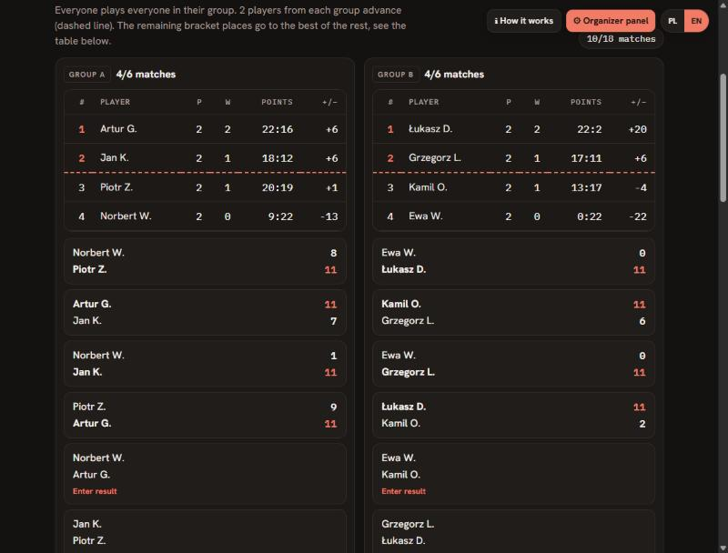 | 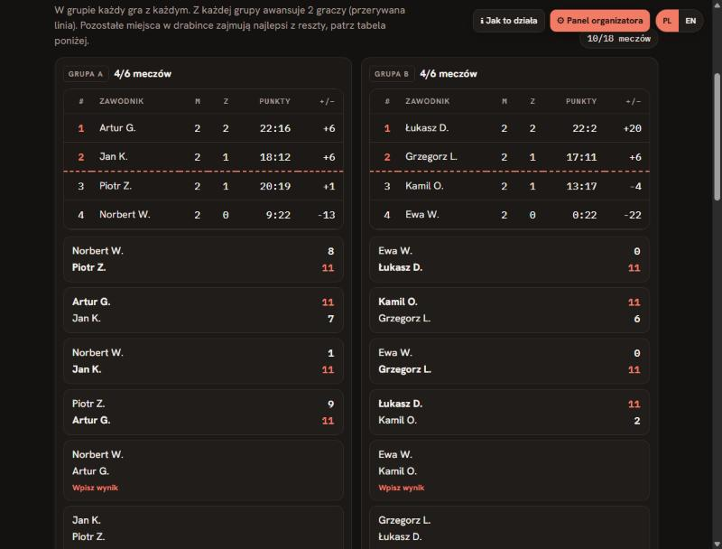 |

---

## How it was built

### Timeline (12 October 2026, from the chat log)

| Time | What happened |
|---|---|
| 20:03 | First prompt: bracket and groups, number of players and groups set in the app, brand colours. |
| 20:04–20:07 | Concept changed on the fly: no group stage, everyone plays two matches, losers get a second chance. A screenshot of a website as colour reference, and the decision to host the page on my own server under an address known only to participants. |
| 20:07–20:20 | More requirements: everyone signs up on their own, a podium with laurels at the end, only the organizer enters results. |
| **~20:24** | **First working version online**, about 20 minutes after the first prompt. |
| 20:25–20:33 | Hotfixes to keep the production version fully working and ready to share with participants: link preview and icon, several sign-ups from one phone, score entry in points. |
| 20:47 | The tournament is running and late players arrive, so adding players mid-round is added. |
| 21:10 | A list of players who are already guaranteed a bracket spot and should not leave. |
| 21:20–21:36 | Lucky Losers rules reworked during round 2, without losing any entered results. |
| 21:51–21:53 | Bracket seeding 1st vs last, a table of all results and an overall standings table. |
| 22:32 | Tournament stats at the end. |

**In short: about 20 minutes to the first version online, then a few iterations of fixes**, mostly during the tournament, once it was clear what was missing.

### Before going public

The version that ran at the event was built for one evening and one company. Before the repository and the demo went public, a few things were fixed so that it could be shown to anyone:

| Area | What was done before publishing |
|---|---|
| **Anonymisation** | All names in the demo tournament are made up. The repository, the code and the screenshots contain no real names, no company name and no address of the server it ran on. The organizer link stays secret: its token lives in the `#admin-…` part of the URL and is never stored in the repo. |
| **Language versions** | An English interface next to the Polish one: PL/EN switch, browser language as the default, `?lang=en` to force a language, choice remembered per device. Every label, dialog, toast and stat card has both languages, server and engine messages are translated in the browser, and the default tournament title is shown translated. The documentation is in English. |
| **Better page layout** | One standings table instead of two, with a view for the qualification cut-offs and a Status column (who is still in, who drops out). Stats are collapsible and sit right under the bracket. The organizer panel is a pop-up behind a button, and a "How it works" button in the top bar replaces scrolling to the bottom. Stat cards, the floating buttons and the mobile layout were checked in a real browser. |
| **Match timer, set scoring and stats** | The organizer taps *Start* on a match and entering the result ends it. Matches to 2 or 3 sets take the points of every set (11:9, 7:11, 12:10) and work out the match score themselves, or the organizer can choose the faster sets-only mode. Stats show match times, deuce games, tight finishes, the biggest upset, matches that went the distance and the comeback king. Both the browser engine and the Python server do the same, and both have tests. |
| **Qualification and knockout formats** | Besides the original two rounds the organizer can choose 1 to 6 random-opponent rounds or a group stage with round-robin groups. The knockout stage is set by the share of players that advance (even numbers, rounded up, recommended near 50%), with optional Lucky Losers decided by a play-off or by the table, and works for any even number of players thanks to a play-in round with byes for the best seeds. Both engines implement it and have tests (rounds 1–6, groups of several sizes, every percentage, both Lucky Losers modes, late players, M−1 matches in every bracket). |
| **Demo** | The page works without a server on GitHub Pages. A *Random tournament* button generates a tournament of a random size and format, and 80 of 80 random tournaments (groups and 1–4 rounds, Lucky Losers off, by play-off and by the table, all score entry modes) were played through to the podium to check it. |
| **Screenshots** | Retaken from the running app (headless Chrome, with seeded random results so they are reproducible): desktop and phone, light and dark, **in English and in Polish**. They only show the anonymised demo data. |
| **Publishing** | GitHub Pages with a workflow that publishes `docs/` on every push, a custom domain, and a link preview (`og:` tags) for messaging apps. |

### Process
- **A conversation instead of a spec.** There was no design and no backlog. Requirements came in consecutive, often dictated messages and changed as we saw how the tournament was going.
- **AI wrote the code, I decided the rules.** For every change to the format (Lucky Losers, seeding, permissions) the decision was mine, and the implementation, deployment and testing were done by the AI.
- **Production changes during the event.** Before every fix the tournament state was backed up. New logic was first checked by simulating a full tournament on a copy of the real data and only then deployed. No entered result was lost.
- **Simple on purpose.** No frameworks, no database, no build step. One HTML file, one Python file and one JSON file with the state. For a few dozen people and one organizer that is plenty.

### What I learned
- For ad-hoc tools, time to the first working version matters most. Everything else gets added once people start using it.
- The tournament rules are the hardest part. Adapting the code is easy, deciding what you actually want while players are waiting is not.
- Simulation tests (a full tournament with random results for 3–40 players) gave confidence when changing things live.

---

## Architecture

```
docs/            frontend + GitHub Pages
  index.html     the whole interface (HTML, CSS and JS in one file)
  engine.js      in-browser tournament engine, used in demo mode
  demo-data.json a real tournament with anonymised names
server/
  server.py      HTTP server and tournament logic (Python, standard library only)
tests/           full-tournament simulations for both engines
```

- **Server mode** (how it ran at the event): `server.py` keeps the state in a single JSON file and exposes a small API (`api/state`, `api/join`, `api/leave`, `api/score`, `api/start`, `api/admin`). Organizer rights come from a token in the `#admin-…` part of the link, which never reaches server logs or the Referer header.
- **Demo mode** (GitHub Pages): the same interface, but instead of the server it uses `engine.js`, a 1:1 port of the logic in `server.py`. The state is stored in the browser's `localStorage`.
- The interface picks the mode by itself: on `github.io`, from a local file or with `?demo` it runs the demo. Otherwise it connects to the server, and if no server API answers (e.g. GitHub Pages on a custom domain), it falls back to the demo.

## Running it yourself

```bash
python3 server/server.py
# Tournament is running: http://localhost:8187/
# Organizer link (do not share): http://localhost:8187/#admin-...
```

Only Python 3.10+ is required. Environment variables: `TT_PORT`, `TT_BIND`, `TT_DATA` (directory for the state and token) and `TT_STATIC`.

To put a tournament online, run the server behind a reverse proxy (e.g. nginx with HTTPS) under a hard-to-guess path. Give participants the regular link and keep the `#admin-…` link to yourself. If you want a nice link preview in messaging apps, change `og:url` and `og:image` in `docs/index.html` to your own address.

## Tests

```bash
python3 -m unittest discover tests   # server logic
node tests/engine.test.mjs            # browser engine
```

Both suites play full tournaments with random results for 3–40 players. They check that everyone plays at least twice, the bracket is full, the seeding is right and scores are validated.

## Privacy

The repository contains no real names, no company name and no address of the server the tournament ran on, and neither do the screenshots. The demo data is the real course of the tournament with made-up names.

## License

[MIT](LICENSE)
