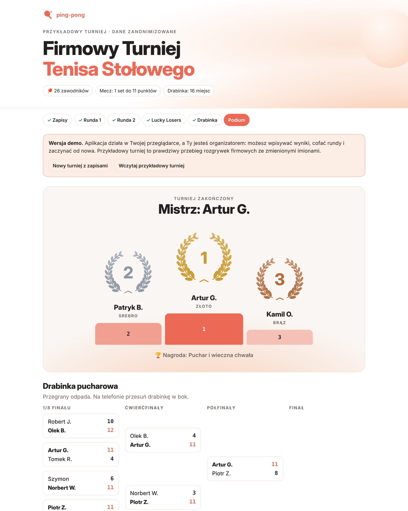
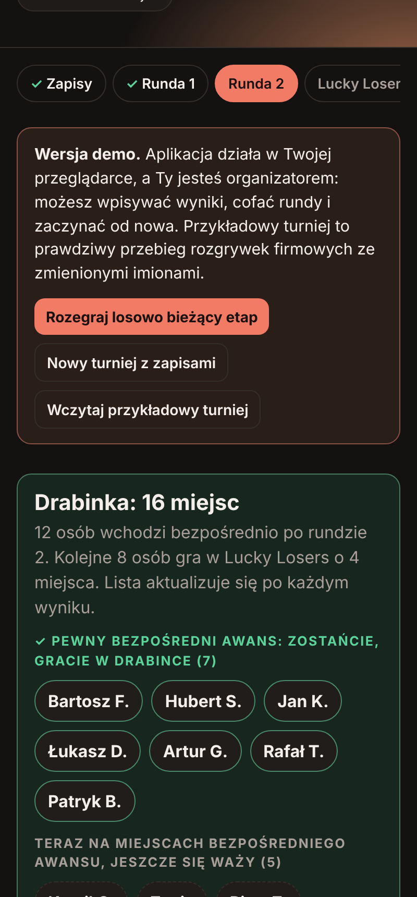
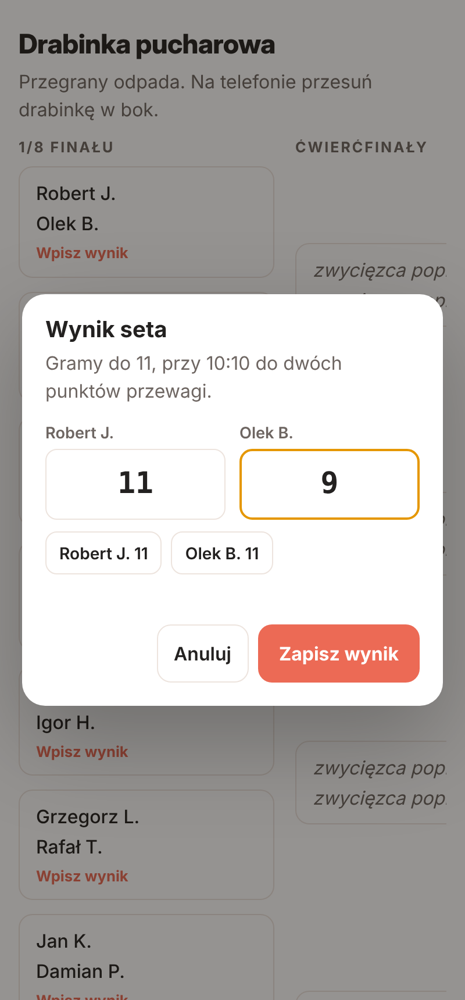

# 🏓 Turniej Tenisa Stołowego

Aplikacja do prowadzenia firmowego turnieju ping-ponga: zapisy po linku, dwie rundy kwalifikacji, Lucky Losers, drabinka pucharowa, podium z laurami, tabela ogólna i statystyki.

**[▶ Otwórz demo](https://mr-powerbi.github.io/table-tennis-tournament/)**: działa w przeglądarce, jesteś organizatorem i możesz rozegrać cały turniej od zapisów do podium.



> **Vibecoded.** Aplikacja powstała w jeden wieczór, w rozmowie z AI (Claude), z potrzeby chwili: na firmowe spotkanie integracyjne, na którym do turnieju, rozgrywanego dla zabawy, zgłosiło się blisko 30 osób. Wszystko powstało na szybko z promptów, w rozmowie z czatem. Większość poleceń dyktowałem głosowo z telefonu, a część funkcji dopisywaliśmy już w trakcie rozgrywek. Poniżej opisuję, jak to przebiegało.

---

## Co potrafi

**Dla uczestników (zwykły link)**
- Dopisanie siebie albo kilku osób z jednego telefonu. Swoje wpisy można wycofać do czasu losowania.
- Podgląd na żywo: strona odświeża się sama co kilka sekund.
- Widok bieżącego etapu, rankingu, drabinki, podium, tabeli ogólnej, wszystkich wyników i statystyk.
- Wyróżnienie meczów osób dopisanych z danego telefonu.

**Dla organizatora (link z tajnym tokenem)**
- Wpisywanie wyników punktami (np. 11:7, 12:10) z walidacją zasad: do 11, dwa punkty przewagi.
- Losowanie ręczne albo automatyczne o ustalonej godzinie.
- Dopisywanie spóźnionych graczy w trakcie rund 1 i 2, tak żeby i tak zagrali dwa mecze.
- Cofanie turnieju do wcześniejszego etapu bez utraty wcześniejszych wyników.
- Ustawienia: nazwa, edycja, nagroda, format meczu (1–3 sety), rozmiar drabinki, liczba miejsc dla Lucky Losers.

**Format turnieju**
1. **Runda 1.** Losowe pary, każdy gra jeden mecz.
2. **Runda 2.** Wygrani grają z wygranymi, przegrani z przegranymi. Po tej rundzie każdy ma za sobą co najmniej dwa mecze.
3. **Ranking.** Zwycięstwa, potem bilans punktów, potem zdobyte punkty.
4. **Awans bezpośredni** dla czołówki rankingu. Już w trakcie rundy 2 strona pokazuje, kto ma pewny awans i może zostać na sali.
5. **Lucky Losers.** Najlepsi spoza bezpośredniego awansu grają jeden mecz (lepszy z rankingu ze słabszym), a zwycięzcy uzupełniają drabinkę.
6. **Drabinka.** Rozstawienie 1. z ostatnim, 2. z przedostatnim i tak dalej, mecz o 3. miejsce i podium.

Przy nieparzystej liczbie graczy osoba bez pary dostaje mecz uzupełniający z losowym rywalem, który liczy się tylko dla niej.

| Runda 2 na telefonie (ciemny motyw) | Wpisywanie wyniku |
|---|---|
|  |  |

---

## Jak to powstało

### Oś czasu (12 października 2026, wieczór)

| Godzina | Co się działo |
|---|---|
| 20:03 | Pierwsze polecenie: drabinka i grupy, liczba graczy i grup ustawiana w aplikacji, kolory firmy. |
| 20:04–20:07 | Zmiana koncepcji w locie: bez fazy grupowej, każdy gra dwa mecze, przegrani dostają drugą szansę. Do tego zrzut strony firmy jako inspiracja kolorów i decyzja, że strona stanie na moim serwerze pod adresem znanym tylko uczestnikom. |
| 20:07–20:20 | Kolejne wymagania: link pójdzie na firmowego WhatsAppa, każdy dopisuje się sam, na koniec podium z laurami, wyniki wpisuje tylko organizator. |
| **~20:24** | **Pierwsza działająca wersja online**, około 20 minut od pierwszego polecenia. |
| 20:25–20:33 | Ikona i podgląd linku, dopisywanie kilku osób z jednego telefonu. Wpisywanie wyników punktami („popraw szybko, bo zaczynamy”). |
| 20:47 | Turniej trwa, przychodzą spóźnieni, więc dochodzi funkcja dopisywania w trakcie rund. |
| 21:10 | Informacja, kto ma już pewny awans i ma nie wychodzić z sali. |
| 21:20–21:36 | Przebudowa zasad Lucky Losers w trakcie rundy 2, bez utraty wpisanych wyników. |
| 21:51–21:53 | Rozstawienie drabinki 1 vs ostatni, tabela wszystkich wyników i tabela ogólna z miejscami. |
| 22:32 | Statystyki turnieju na koniec wieczoru. |

Łącznie około 2,5 godziny, z czego większość równolegle z trwającym turniejem.

### Proces
- **Rozmowa zamiast specyfikacji.** Nie było projektu ani backlogu. Wymagania pojawiały się w kolejnych, często dyktowanych wiadomościach i zmieniały się w miarę, jak było widać, jak turniej idzie na sali.
- **AI pisało kod, ja decydowałem o zasadach.** Przy każdej zmianie formatu (Lucky Losers, rozstawienie, uprawnienia) decyzja była moja, a implementacja, wdrożenie i testy po stronie AI.
- **Zmiany na produkcji w trakcie zawodów.** Przed każdą poprawką robiona była kopia stanu turnieju. Nowa logika była najpierw sprawdzana symulacją pełnego turnieju na kopii prawdziwych danych, a dopiero potem wdrażana. Żaden wpisany wynik nie zginął.
- **Prostota z wyboru.** Brak frameworków, bazy danych i kroku budowania. Jeden plik HTML, jeden plik Pythona i jeden plik JSON ze stanem. Przy kilkudziesięciu osobach i jednym organizatorze to w zupełności wystarcza.

### Czego się nauczyłem
- Przy doraźnych narzędziach najważniejszy jest czas do pierwszej działającej wersji. Resztę i tak dopisuje się dopiero, gdy ludzie zaczną z niej korzystać.
- Zasady turnieju to najtrudniejsza część. Kod do nich dostosować łatwo, gorzej z ustaleniem, czego się właściwie chce, gdy na sali czekają gracze.
- Testy symulacyjne (pełny turniej z losowymi wynikami dla 3–40 graczy) dawały pewność przy zmianach na żywo.

---

## Architektura

```
docs/            frontend + GitHub Pages
  index.html     cały interfejs (HTML, CSS, JS w jednym pliku)
  engine.js      silnik turnieju w przeglądarce, używany w trybie demo
  demo-data.json przebieg prawdziwego turnieju z zanonimizowanymi imionami
server/
  server.py      serwer HTTP i logika turnieju (Python, tylko biblioteka standardowa)
tests/           symulacje pełnych turniejów dla obu silników
```

- **Tryb serwerowy** (tak działało to na turnieju): `server.py` trzyma stan w jednym pliku JSON i udostępnia proste API (`api/state`, `api/join`, `api/score`, `api/admin`). Uprawnienia organizatora daje token w części `#admin-…` linku. Nie trafia on do logów serwera ani do nagłówka Referer.
- **Tryb demo** (GitHub Pages): ten sam interfejs, ale zamiast serwera działa `engine.js`, czyli przeniesiona 1:1 logika z `server.py`. Stan zapisuje się w `localStorage` przeglądarki.
- Interfejs wybiera tryb sam: na `github.io`, z pliku lub z parametrem `?demo` działa demo, w pozostałych przypadkach łączy się z serwerem.

## Uruchomienie u siebie

```bash
python3 server/server.py
# Turniej działa: http://localhost:8187/
# Link organizatora (nie udostępniaj): http://localhost:8187/#admin-...
```

Wymagany jest tylko Python 3.10+. Zmienne środowiskowe: `TT_PORT`, `TT_BIND`, `TT_DATA` (katalog na stan i token) oraz `TT_STATIC`.

Żeby wystawić turniej do internetu, uruchom serwer za reverse proxy (np. nginx z HTTPS) pod trudną do zgadnięcia ścieżką i podaj uczestnikom zwykły link, a link z `#admin-…` zachowaj dla siebie. Pamiętaj, żeby podmienić `og:url` i `og:image` w `docs/index.html` na swój adres, jeśli zależy Ci na ładnym podglądzie linku w komunikatorach.

## Testy

```bash
python3 -m unittest discover tests   # logika serwera
node tests/engine.test.mjs            # silnik przeglądarkowy
```

Oba zestawy rozgrywają pełne turnieje z losowymi wynikami dla 3–40 graczy. Sprawdzają przy tym, że każdy gra co najmniej dwa mecze, drabinka jest pełna, rozstawienie się zgadza, a punkty są walidowane.

## Prywatność

W repozytorium nie ma prawdziwych imion, nazwy firmy ani adresu, pod którym działał turniej. Dane w demo to prawdziwy przebieg rozgrywek z wymyślonymi imionami.

---

## English summary

A small web app for running an office table-tennis tournament: sign-ups via a shared link, two qualifying rounds (everyone plays at least twice), a Lucky Losers round, a seeded knockout bracket, a podium, an overall table and stats. It was **vibecoded with Claude in a single evening** for a company team-building event where close to 30 people signed up to play for fun, with the first version live about 20 minutes after the first prompt and many features added while the tournament was being played. The backend is a single stdlib-only Python file storing state in JSON. The GitHub Pages demo runs a 1:1 JavaScript port of the same logic in the browser.

## Licencja

[MIT](LICENSE)
